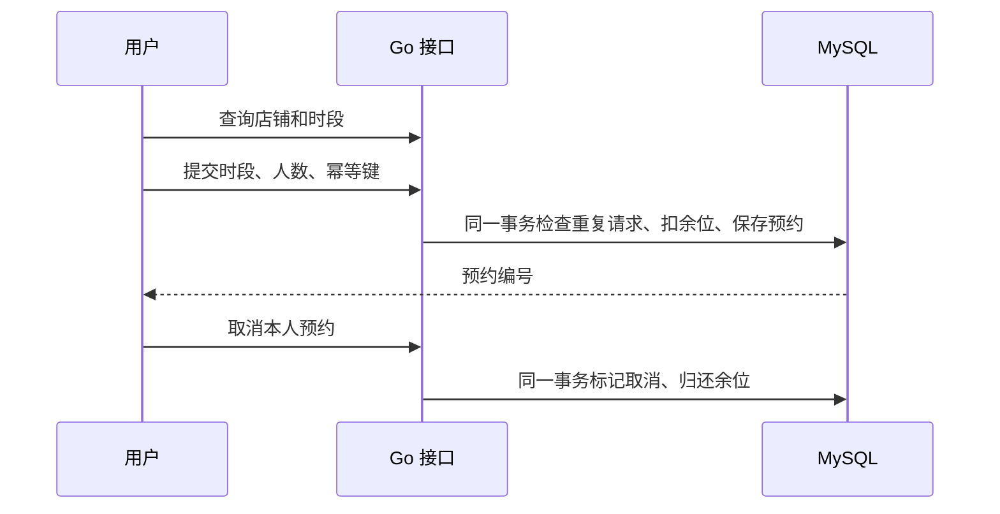

# 找店、预约、签到奖励和邮件验证码契约草案

保留 Hertz 单体。按以下顺序分批验收。

| 模块与目录 | HTTP 契约、状态与验收 |
|---|---|
| 热门笔记 internal/social | GET /blog/hot 沿用现有分页。前 100 个编号作为一个快照发布，每 30 秒刷新。Redis 不可用或页面超出快照时走现有 SQL。比较相同响应下的排序查询次数。 |
| 找店 internal/discovery | GET /shops/search?q=&typeId=&x=&y=&radiusMeters=&page=，返回按距离、ID 排序的商铺；关键词、分类、距离在分页前筛选。第一版使用现有 MySQL，写测试覆盖最近一页无匹配、下一页有匹配的情况。 |
| 到店预约 internal/booking | GET /shops/:id/slots；本店店员 POST /shops/:id/slots 设置开始时间、结束时间、容量。登录用户 POST /slots/:id/bookings 提交人数和 Idempotency-Key，GET /bookings/:id 查看本人预约，POST /bookings/:id/cancel 取消开始前的预约。并发占最后一位、重复提交、越权、取消释放各有验收。 |
| 签到奖励 internal/rewards | 保留今日签到；GET /user/sign/reward 返回月份、达标天数、当前天数及奖励；POST /user/sign/reward/claim 领取。示例规则为每自然月累计签到 7 天可领一次指定普通券，奖券独立于秒杀库存。 |
| 邮件 internal/verification | POST /user/email/code 发验证码；POST /user/email/login 用邮箱和验证码登录；已登录用户 POST /user/email/bind 用验证码绑定邮箱。邮箱唯一，原手机登录保留。Redis 原子限制邮箱和 IP 的频率，一次性校验，失败尝试有上限。SMTP 由环境配置，Compose 验收用本地邮件接收器。 |
| 分桶 internal/trade | 先做可复现的 K=1/K=4 对照实验，使用相同 1000 人抢 100 券负载并增加买家偏斜用例。检查买家去重、桶间余量、候补、关单回补和对账。默认 K=1；集群实验单独配置。 |

拟新增 SQL（最终迁移在各阶段提交）：

```sql
CREATE TABLE booking_slot(id BIGINT PRIMARY KEY AUTO_INCREMENT, shop_id BIGINT NOT NULL, starts_at DATETIME NOT NULL, ends_at DATETIME NOT NULL, capacity INT NOT NULL, remaining INT NOT NULL, UNIQUE(shop_id,starts_at));
CREATE TABLE booking(id BIGINT PRIMARY KEY AUTO_INCREMENT, slot_id BIGINT NOT NULL, user_id BIGINT NOT NULL, party_size INT NOT NULL, request_key VARCHAR(64) NOT NULL, cancelled_at DATETIME NULL, UNIQUE(user_id,request_key));
CREATE TABLE sign_reward_rule(month_start DATE PRIMARY KEY, days_required INT NOT NULL, voucher_id BIGINT NOT NULL);
CREATE TABLE sign_reward_grant(user_id BIGINT NOT NULL, month_start DATE NOT NULL, voucher_id BIGINT NOT NULL, granted_at DATETIME NOT NULL, PRIMARY KEY(user_id,month_start));
CREATE TABLE user_email(user_id BIGINT PRIMARY KEY, email VARCHAR(254) NOT NULL UNIQUE);
```

邮箱新用户需支持无手机号；审核现有 tb_user.phone 唯一约束后迁移为可空，已有账号保留原值。奖励记录即用户的普通券权益。交易状态与预约、签到相互独立。Redis 键采用 xzdp:<env>:social:hot-rank、xzdp:<env>:verification:<用途>:<邮箱或IP摘要>；实验库存键用 {活动ID:桶号} 同槽。预约以 SQL 为准。



签到 → 读取本月签到天数 → 达标后唯一约束发券；申请验证码 → 检查频率 → SMTP 投递 → 一次性核验 → 建立会话。AI 和个性化推荐本轮先调研；如接入，助手复用找店与预约业务接口，由登录用户确认写入。
