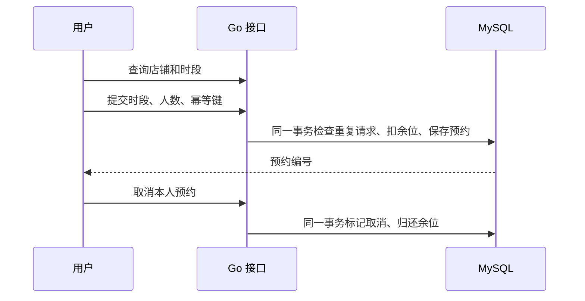

# 找店、预约、签到奖励和邮件验证码接口契约与验收

服务沿用 Hertz 单体。热门笔记、附近搜索、预约、签到奖励和邮箱验证各自注册路由，库存分桶使用单独的实验环境。

| 模块与目录 | HTTP 契约、状态与验收 |
|---|---|
| 热门笔记 internal/social | GET /blog/hot 沿用现有分页。前 100 个编号作为一个快照发布，每 30 秒刷新。Redis 不可用或页面超出快照时走现有 SQL。比较相同响应下的排序查询次数。 |
| 找店 internal/discovery | GET /shops/search?q=&typeId=&x=&y=&radiusMeters=&page=，返回按距离、ID 排序的商铺；关键词、分类、距离在分页前筛选。第一版使用现有 MySQL，写测试覆盖最近一页无匹配、下一页有匹配的情况。 |
| 到店预约 internal/booking | GET /shops/:id/slots；本店店员 POST /shops/:id/slots 设置开始时间、结束时间、容量。登录用户 POST /slots/:id/bookings 提交人数和 Idempotency-Key，GET /bookings/:id 查看本人预约，POST /bookings/:id/cancel 取消开始前的预约。并发占最后一位、重复提交、越权、取消释放各有验收。 |
| 签到奖励 internal/rewards | 保留今日签到；GET /user/sign/reward 返回月份、达标天数、当前天数及奖励；POST /user/sign/reward/claim 领取。示例规则为每自然月累计签到 7 天可领一次指定普通券，奖券独立于秒杀库存。 |
| 邮件 internal/verification | POST /user/email/code 发验证码；POST /user/email/login 用邮箱和验证码登录；已登录用户 POST /user/email/bind 用验证码绑定邮箱。邮箱唯一，原手机登录保留。Redis 原子限制邮箱和 IP 的频率，一次性校验，失败尝试有上限。SMTP 由环境配置，Compose 验收用本地邮件接收器。 |
| 分桶 internal/trade | 先做可复现的 K=1/K=4 对照实验，使用相同 1000 人抢 100 券负载并增加买家偏斜用例。检查买家去重、桶间余量、候补、关单回补和对账。默认 K=1；集群实验单独配置。 |

服务启动时自动应用 [007_discovery.sql](../internal/migrate/sql/007_discovery.sql)。新增表的主要字段如下。

```sql
CREATE TABLE booking_slot(id BIGINT PRIMARY KEY AUTO_INCREMENT, shop_id BIGINT NOT NULL, starts_at DATETIME NOT NULL, ends_at DATETIME NOT NULL, capacity INT NOT NULL, remaining INT NOT NULL, UNIQUE(shop_id,starts_at));
CREATE TABLE booking(id BIGINT PRIMARY KEY AUTO_INCREMENT, slot_id BIGINT NOT NULL, user_id BIGINT NOT NULL, party_size INT NOT NULL, request_key VARBINARY(64) NOT NULL, cancelled_at DATETIME NULL, UNIQUE(user_id,request_key));
CREATE TABLE sign_reward_rule(month_start DATE PRIMARY KEY, days_required INT NOT NULL, voucher_id BIGINT NOT NULL);
CREATE TABLE sign_reward_grant(user_id BIGINT NOT NULL, month_start DATE NOT NULL, voucher_id BIGINT NOT NULL, granted_at DATETIME NOT NULL, PRIMARY KEY(user_id,month_start));
CREATE TABLE user_email(user_id BIGINT PRIMARY KEY, email VARCHAR(254) NOT NULL UNIQUE);
```

邮箱注册的用户初始手机号为 NULL。迁移保留 tb_user.phone 的唯一索引和已有号码。奖励记录即用户的普通券权益。交易状态与预约、签到相互独立。Redis 键采用 xzdp:<env>:social:hot-rank、xzdp:<env>:verification:<用途>:<邮箱或IP摘要>；实验库存键用 {活动ID:桶号} 同槽。预约以 SQL 为准。



签到 → 读取本月签到天数 → 达标后唯一约束发券；申请验证码 → 检查频率 → SMTP 投递 → 一次性核验 → 建立会话。AI 和个性化推荐本轮先调研；如接入，助手复用找店与预约业务接口，由登录用户确认写入。

## 客户端调用

接口使用现有的 `success`、`data`、`errorMsg` 响应格式。需要登录时，在 `Authorization` 请求头原样发送登录返回的 token。

| 操作 | 请求和返回 |
|---|---|
| 附近搜索 | `GET /shops/search?x=120&y=30&q=咖啡&typeId=1&page=1`。x 为经度，y 为纬度，默认半径 5000 米，每页 10 条。结果包含 id、name、typeId 和 distanceMeters，同距离按 id 升序。 |
| 发布时段 | 店员向 `POST /shops/:id/slots` 发送 `{"startsAt":"2030-05-01T10:00:00+08:00","endsAt":"2030-05-01T11:00:00+08:00","capacity":4}`，成功返回时段编号。时间使用 RFC 3339，按 UTC 存储。公开时段列表包含未来时段及各自的 remaining。 |
| 预约与取消 | `POST /slots/:id/bookings` 发送 `{"partySize":2}`，并携带 1 至 64 字节的 `Idempotency-Key`。同一用户重试应复用原键，相同时段和人数返回同一编号。查单与取消限本人，已开始的时段不能取消。 |
| 签到领券 | 查询和领取均返回 month、days、daysRequired、voucherId、claimed。达到天数后可在当月领取，在同月重复领取返回既有权益。默认奖励是种子数据中编号 1 的上架普通券，可以按月向 sign_reward_rule 写入门槛和券号。 |
| 邮件验证 | 发码发送 `{"email":"me@example.com","purpose":"login"}`。绑定时改用 bind 并携带当前会话。登录和绑定均发送 email、code 两个字符串字段。验证码有效期 5 分钟，可尝试 5 次。同邮箱 60 秒限发一次，单个连接来源 IP 每 10 分钟限发 20 次。绑定后，两种登录方式进入同一账号。 |

## 独立复验

在仓库根目录运行。第一个命令可单独验收现有热门榜，覆盖排行榜快照、连续读取和刷新失败后保留旧榜。

```sh
go test -count=1 ./internal/social ./biz/service/blog -run 'TestHotRank|TestHotPages|TestGetHotBlog'
XZDP_SMTP_ADDRESS=mailpit:1025 docker compose --profile mail up -d --build --wait
python3 script/load/discovery.py
sh script/load/buckets.sh
```

HTTP 验收使用真实 MySQL、Redis 和本地 Mailpit 收件箱。用例覆盖第 12 近的关键词匹配、抢最后一个名额、同键重试、越权查看与取消、签到并发领取、验证码单次使用和绑定后登录。月初尚未达到签到门槛时，固定日期的 Go 测试可单独复验达标及跨月行为。

默认 Compose 启动六个服务。mail 配置组额外运行一个内存上限为 64 MiB 的 Mailpit。使用正式邮箱时配置 XZDP_SMTP_ADDRESS（主机和端口）、XZDP_SMTP_FROM，以及需要认证时的 XZDP_SMTP_USER 和 XZDP_SMTP_PASSWORD。外部 SMTP 使用 STARTTLS。

## 库存分桶结果

在隔离的三主节点 Redis Cluster 中，1000 个买家争抢 100 张券。各桶按买家编号分配，四桶各有 25 张券。

| 买家分布 | 单桶受理 | 四桶受理 | 四桶受理结束时的剩余库存 |
|---|---:|---:|---:|
| 均匀分布 | 100 | 100 | 0 |
| 全部路由至同一桶 | 100 | 25 | 75 |

实验还校验了重复购买、桶内候补转正、取消回补，以及受理结果与各桶账目的一致性。四桶在买家偏斜时会少卖，因此业务秒杀链路继续使用单桶。实验测量范围为 Redis 受理阶段，Kafka 消费与 MySQL 订单由原交易验收脚本覆盖。

## AI 与推荐调研

Java 版 hmdp-ai-agent 已把商铺搜索、排队取号和查看排队进度做成 Agent 可调用的工具。这个 Go 项目可复用本次的找店和时段查询接口回答“附近哪里还有两人位”，用户选定门店和时间后再通过已有预约接口提交。[商铺搜索实现](https://github.com/yeffky/hmdp-ai-agent/blob/29025a5b134d94a98f29ecf05543f9b16afbbbda/hm-dianping/src/main/java/com/hmdp/agent/tool/ShopSearchTool.java) · [排队工具实现](https://github.com/yeffky/hmdp-ai-agent/blob/29025a5b134d94a98f29ecf05543f9b16afbbbda/hm-dianping/src/main/java/com/hmdp/agent/tool/QueueTicketTool.java)

个性化推荐可参考 Go 项目 Gorse。它将训练、离线推荐和在线读取拆开。若后续有足够的点赞、预约和核销样本，可以先离线验证这些信号能否帮助用户找到愿意去的店，再决定是否引入独立服务。[Gorse 项目与架构](https://github.com/gorse-io/gorse#architecture)
