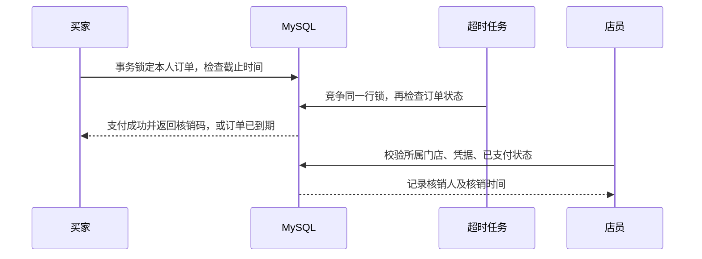

# 模拟付款与门店核销契约

internal/trade/payment.go 负责支付和核销规则，internal/trade/http.go 注册两个操作；internal/migrate/sql/006_payment.sql 保存下列结构；随仓前端增加买家订单状态和店员核销入口。订单状态查询沿用已有接口，沿用登录会话；没有新增 Redis key。

| 操作 | 输入 | 成功行为 |
|---|---|---|
| POST /voucher-order/pay/:id | 本人登录凭据、订单号 | 返回 paid 和随机核销码。同一买家重复付款返回相同凭据。只允许在 15 分钟窗口内操作。 |
| POST /voucher-order/redeem/:id | 已分配本店权限的店员登录凭据、核销码 | 仅本店可将 paid 改为 used。重复请求不能再次核销。 |
| GET /voucher-order/status/:id | 买家登录凭据、订单号 | 保留 queued、unpaid、paid、used、cancelled 等现有字符串格式。 |

已实施的表结构：

```sql
CREATE TABLE voucher_redemption (
    order_id BIGINT PRIMARY KEY,
    code CHAR(32) CHARACTER SET ascii COLLATE ascii_bin NOT NULL UNIQUE,
    redeemed_by BIGINT NULL
);
CREATE TABLE shop_staff (
    shop_id BIGINT NOT NULL,
    user_id BIGINT NOT NULL,
    PRIMARY KEY (shop_id, user_id)
);
```



验收包括其他用户付款、逾期付款、同一订单并发支付与取消、跨店核销、无权限核销、重复核销。模拟付款功能须显式启用，仅供本地演示。

## 本地运行

```sh
XZDP_MOCK_PAYMENT=true docker compose up -d --build --wait
python3 script/load/payment.py
```

本地默认关闭两个模拟操作。验收后使用 `docker compose up -d --wait api` 恢复默认配置。该流程不扣款、不连接第三方支付。核销接口接受 JSON 请求体 `{"code":"买家展示的32位核销码"}`。状态查询仍只允许订单本人访问；已支付的买家可以再次点「显示我的核销码」。订单号按十进制字符串传输，页面不会把它转换为 JavaScript 数字。

使用仓库附带的前端包运行 Nginx，登录后从「个人主页 → 优惠券订单与核销」进入，抢券受理后也会自动进入本单。买家可以刷新排队状态、模拟付款和出示核销码；店员用自己的账号输入订单号和核销码。用本地数据库管理账号在 `shop_staff(shop_id,user_id)` 登记实际店员与门店的对应关系。演练脚本会创建并验证自己的临时授权，完成后清理。

付款、发码在同一 MySQL 事务中完成。核销时用优惠券所属门店匹配当前店员；核销时间、订单状态和核销人也在一个事务中提交。过期判断在取得订单锁之后使用数据库时间，即使付款请求因锁等待跨过截止时间也无法付款。订单支付与取消竞争同一行；已支付订单不参与超时释放。
