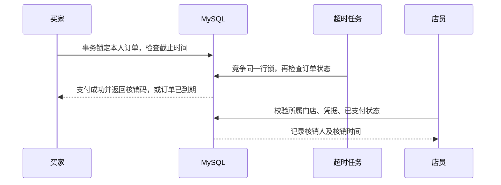

# 模拟付款与门店核销契约（待确认）

目录变更：internal/trade/payment.go 负责支付和核销规则，internal/trade/http.go 注册两个操作；internal/migrate/sql/006_payment.sql 保存下列结构；随仓前端增加买家订单状态和店员核销入口。订单状态查询沿用已有接口，沿用登录会话；没有新增 Redis key。

| 操作 | 输入 | 成功行为 |
|---|---|---|
| POST /voucher-order/pay/:id | 本人登录凭据、订单号 | 返回 paid 和随机核销码。同一买家重复付款返回相同凭据。只允许在 15 分钟窗口内操作。 |
| POST /voucher-order/redeem/:id | 已分配本店权限的店员登录凭据、核销码 | 仅本店可将 paid 改为 used。重复请求不能再次核销。 |
| GET /voucher-order/status/:id | 买家登录凭据、订单号 | 保留 queued、unpaid、paid、used、cancelled 等现有字符串格式。 |

拟议迁移：

```sql
CREATE TABLE voucher_redemption (
    order_id BIGINT PRIMARY KEY,
    code CHAR(32) CHARACTER SET ascii COLLATE ascii_bin NOT NULL UNIQUE,
    redeemed_by BIGINT NULL
);
CREATE TABLE shop_staff (
    shop_id BIGINT NOT NULL,
    user_id BIGINT NOT NULL,
    PRIMARY KEY (shop_id, user_id)
);
```



验收包括其他用户付款、逾期付款、同一订单并发支付与取消、跨店核销、无权限核销、重复核销。模拟付款功能须显式启用，仅供本地演示。
