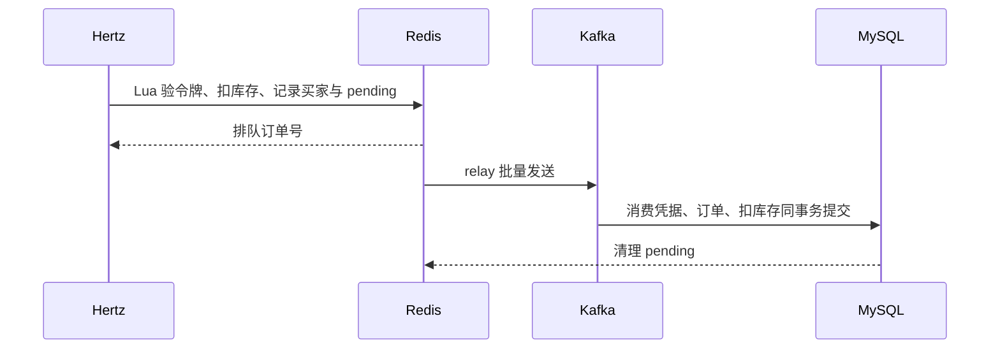

# 订单契约

HTTP 成功结果在 data 字段，订单号以十进制字符串传输，避免 JavaScript 精度损失。所有接口均使用既有 Authorization 登录凭据。POST /voucher-order/token/:id 获取本人当前活动的 30 秒令牌；POST /voucher-order/seckill/:id 通过 X-Seckill-Token 提交；GET /voucher-order/status/:id 查询本人订单。领令牌和提交采用 Redis 滑动窗口，默认每秒每 IP 2500、每路径 5000、每用户 10。重复领令牌在有效期内返回同一凭据。

internal/trade/sale.go 管理资格，worker.go 负责传输和落库，http.go 只处理协议。internal/migrate/sql 中的前向 SQL 同时适用于新卷和旧卷。迁移锁串行执行 DDL；历史重复订单会阻止唯一索引创建，运维人员应先核查历史业务数据。消费失败重试三次后写 Kafka DLQ 与 MySQL 死信表。Redis pending 的生命周期独立于订单业务状态。Redis 必须持久化且禁止驱逐交易键。

Redis 前缀为 xzdp:<env>:trade:。v:<id> 保存库存与时间窗口，:buyers 是用户到订单的映射，:token:<user> 是短期凭据；pending 保存未完成的投递记录，relay 按下次投递时间排序。序列键 sequence 不得重置。Kafka 主 topic 为 xzdp-<env>-orders，死信 topic 加 .dlq。

设计对照：[Go Lua 入队](https://github.com/wengyuechuan/hm-dianping-go/blob/main/script/seckill.lua)、[Go Kafka pending 重投](https://github.com/amemiya02/hmdp-go/blob/main/internal/service/voucher_order.go)。本项目使用同一个订单号串起预扣、投递和 DB 凭据。

## 关单、候补与提醒

POST /voucher-order/cancel/:id 取消本人未支付订单；POST /voucher-order/wait/:id 对售罄的活动候补；POST /voucher-order/subscribe/:id 订阅未开始活动；GET /notifications 返回本人最近 50 条通知。订单状态只在 SQL 中使用条件更新。定时任务扫描超过 15 分钟的未支付订单，复用取消事务。
数据库迁移 003 增加库存释放事件、订阅与站内通知。释放任务在 Redis 利用订单号去重，将库存交给最早的候补者或退回库存。候补订单复用同一条 Kafka 消费链。订阅提醒在开抢前五分钟写入通知表，再发送到已有 SSE Stream。
参考 [Java Plus 延时通知](https://github.com/java-up-up/hmdp-plus/tree/HEAD/hmdp-core-service/src/main/java/org/javaup/delay/consumer) 和 [go-zero 订单生命周期](https://github.com/me-cs/dianping-gozero/tree/main/rpc/order/internal/logic)。

## 点赞与关注流

`internal/social/likes.go` 保留既有点赞用户 ZSet。Lua 同步修改成员关系、计数及脏集合；四个 worker 每秒最多领取 128 个热点笔记，以版本条件写回绝对计数。MySQL 写失败时保留脏记录，同版本成功后才能清理。笔记详情优先显示 Redis 中的即时计数。Redis 使用 AOF；MySQL 中的计数无法单独恢复点赞成员关系。

`internal/social/feed.go` 在发帖事务内记录投递方式。少于一万粉丝的作者向收件箱推送，同一帖子重投使用相同 ZSet member。达到阈值的作者按读请求合并。发布时固定模式，作者之后跨越阈值时旧帖依然可见。迁移见 `004_social.sql`；原有收件箱与分页字段继续使用。缓存键为 `xzdp:<env>:social:like:<blog>` 和 `xzdp:<env>:social:dirty`。参考 Java 版点赞与收件箱的 ZSet 用法，以及 go-zero 版对同分值时间游标的处理。[BlogServiceImpl](https://github.com/java-up-up/hmdp-plus/blob/HEAD/hmdp-core-service/src/main/java/org/javaup/service/impl/BlogServiceImpl.java) · [QueryBlogsOfFollow](https://github.com/me-cs/dianping-gozero/blob/HEAD/rpc/blog/internal/logic/queryblogsoffollowlogic.go)
