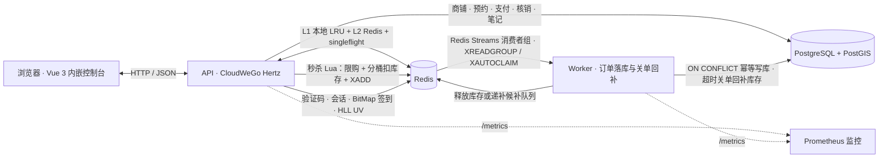

# 小众点评 (xzdp-go)

小众点评是一个基于 Go 和 Vue 3 编写的本地生活与高并发秒杀平台，拆分为 **API** 和 **Worker** 两个独立进程，底层只依赖 **PostgreSQL（含 PostGIS）** 和 **Redis**：
- **API 进程**（CloudWeGo Hertz + `embed.FS` 内嵌前端）：负责验证码登录、月度签到领券、附近商铺地理搜索、门店预约、探店笔记社交以及优惠券秒杀受理与核销。
- **Worker 进程**（Redis Streams 消费者组）：独立消费秒杀排队消息并幂等写入 PostgreSQL，同时负责超时未支付订单自动关单、库存回补与候补自动递补，以及崩溃节点遗留消息的自动接管。
- **HTTP 框架与精简依赖**：保留字节跳动 CloudWeGo Hertz 高性能网络框架，直接用纯 Go 编写路由和处理逻辑（不引入 Thrift IDL、代码生成器、GORM 和 Kafka），运行时仅引入 5 个核心第三方库：`hertz`、`pgx/v5`、`go-redis/v9`、`prometheus/client_golang`、`golang.org/x/sync`。

## 系统架构



## 核心设计说明

1. **一次 Redis Lua 脚本原子完成“限购、扣库存、入队”，杜绝超卖和消息丢失。** 秒杀抢券时，通过预编译 Lua 脚本（`EVALSHA` 缓存）在一次执行里同时校验活动时间、检查是否一人一单、扣减库存，并立刻执行 `XADD` 写入 Redis Stream。这样不会出现“库存扣了但订单消息发丢”的中间状态。支持通过 `STOCK_BUCKETS` 将库存拆成多个子桶（1–64），便于在热点场景下分散单 Key 写入压力。
2. **用 Redis Streams 消费者组做异步落库和故障接管，不额外引入 Kafka。** 独立 Worker 通过 `XREADGROUP` 批量拉取秒杀订单，写入 PostgreSQL 时配合 `ON CONFLICT (id) DO NOTHING` 保证幂等，确认数据库事务提交后再通过 Lua 脚本原子执行 `XACK` 与 `XDEL`（异常订单记入死信表和死信流，且防止并发接管重复写入死信）。如果某个 Worker 崩溃，其他 Worker 会定时用 `XAUTOCLAIM` 接管超过空闲阈值的未确认消息，做到零丢单。
3. **超时未支付自动关单、库存回补与候补队列递补。** 订单超过 15 分钟未付款，Worker 通过 `FOR UPDATE SKIP LOCKED` 批量锁定超时订单，在同一个数据库事务里关闭订单、加回数据库库存并记录一条待释放记录（`trade_release`）；随后通过 Lua 脚本把库存精确归还到原分桶，如果当前有排队候补的买家且活动未结束，则直接原子递补生成新订单。
4. **商铺详情采用多级缓存，同时防缓存击穿和缓存穿透。** 查询商铺详情时先读进程内有界 LRU 缓存（L1），未命中再读 Redis（L2），都未命中则通过 `singleflight` 把同一时刻的大量并发回源合并成一次数据库查询。缓存项采用逻辑过期策略：超过刷新时间后先返回旧值并在后台异步刷新，避免瞬间打穿数据库；查询不存在的商铺会写入 15 秒短空值缓存防穿透。
5. **用 PostGIS 空间索引做附近商铺搜索，用 Redis 位图做签到统计。** 商铺坐标建立 PostGIS 地理索引，附近找店结合 `ST_DWithin` 距离过滤、分类条件与关键词排序，一次 SQL 返回精确距离。用户月度签到直接存 Redis BitMap（每天 1 bit），支持高效统计本月累计天数与连续签到天数，达到满勤天数后在事务内自动发放普通优惠券。
6. **低基数监控指标与平滑停机。** API 和 Worker 均暴露 `/livez`（存活检查）、`/readyz`（就绪检查）和 `/metrics`（Prometheus 指标），指标标签只包含路由模板和固定枚举，严禁把商铺 ID、用户 ID 或订单号放入标签。收到 `SIGTERM` 停机信号后，服务先将 `/readyz` 切换为 503 停止接入新请求，再等待正在处理的请求和消息消费完成后退出。

## 性能测试结果

测试环境：Apple M4、macOS arm64、Go 1.27.3；PostgreSQL 17.6、PostGIS 3.5.3、Redis 8.8.4。本机单轮实测，完整数据与复现命令见[性能测试报告](docs/benchmarks.md)。

| 测试场景 | 测试条件 | 实测结果 |
|---|---|---|
| 秒杀并发（单桶 / 八桶） | 200 并发抢 100 张券 + 模拟 10 条崩溃消息接管 | 均落库 **100 / 100**，超卖 **0**、重复单 **0**、丢单 **0**，Pending 接管 **10 / 10**；受理吞吐单桶 **37,068 QPS**（P99 4.69 ms）、八桶 **30,659 QPS**（P99 5.97 ms） |
| 商铺多级缓存击穿保护 | 200 并发冷读同一商铺 | 仅回源数据库 **1 次**（`singleflight` 合并生效），吞吐 **122,665 QPS**（P99 1.54 ms） |
| 商铺缓存读取（L1 / Redis） | 64 并发，5,000 次读取 | L1 进程内缓存 **400 万 QPS**（P99 0.29 ms）；Redis 缓存 **29,781 QPS**（P99 9.16 ms） |
| PostGIS 附近商铺搜索 | 10,000 家商铺，20 并发，带关键词与距离排序 | **1,767 QPS**，P50 **8.55 ms**，P99 **62.64 ms** |

## 核心接口

| 方法与路径 | 说明 |
|---|---|
| POST `/user/email/code` · `/user/email/login` · `/user/logout` | 获取验证码、登录（返回 Bearer Token）与退出登录 |
| POST `/user/sign` · GET `/user/sign/reward` | 每日签到、查询本月累计/连续签到与满勤领券进度 |
| GET `/shops/search` · GET `/shops/{id}` · GET `/categories` | 附近商铺地理搜索、商铺详情（多级缓存）与分类列表 |
| GET `/shops/{id}/slots` · POST `/slots/{id}/bookings` · `/bookings/{id}/cancel` | 查看门店可预约时段、幂等预约与取消预约 |
| GET `/vouchers` · POST `/vouchers/{id}/buy` · `/vouchers/{id}/wait` | 查看优惠券、秒杀抢购与售罄候补排队 |
| GET `/orders` · GET `/orders/{id}` · POST `/orders/{id}/pay` · `/cancel` · `/redeem` | 查询订单与排队状态、模拟支付生成核销码、取消订单与门店核销 |
| GET/POST `/notes` · GET `/feed` · POST `/notes/{id}/like` · `/comments` | 探店笔记、关注流、点赞与评论 |
| POST/DELETE `/following/{id}` · GET `/following/{id}/common` | 关注/取关与共同关注查询 |
| GET `/livez` · `/readyz` · `/metrics` | 存活检查、就绪检查与 Prometheus 监控指标 |

## 项目结构

```text
xzdp-go/
├── cmd/
│   ├── api/            # Hertz HTTP 服务启动入口（含内嵌前端）
│   ├── worker/         # Redis Streams 秒杀订单落库与超时关单进程入口
│   └── bench/          # 缓存、秒杀一致性与 PostGIS 附近搜索压测工具
├── internal/
│   ├── cache/          # 进程内 LRU + Redis + singleflight 逻辑过期多级缓存
│   ├── httpapi/        # Hertz 路由注册、鉴权/限流/UV 中间件、内嵌静态资源与平滑停机
│   ├── metrics/        # 低基数 Prometheus 指标注册
│   ├── shop/           # 商铺详情、PostGIS 附近搜索与门店预约
│   ├── social/         # 探店笔记、评论、点赞、关注与关注流
│   ├── store/          # pgx/v5 连接池、embed.FS 内嵌 SQL 迁移与演示数据初始化
│   ├── trade/          # 秒杀 Lua、分桶库存、Redis Streams 消费、支付核销、关单回补与候补
│   └── user/           # 邮箱/短信验证码登录、会话与 BitMap 月度签到领券
├── frontend/           # Vue 3 + TypeScript + Tailwind CSS v4 暗色体验台（产物内嵌至 Go）
├── deploy/             # Prometheus 采集配置
├── docs/               # 性能测试报告与原始数据
├── Makefile
└── docker-compose.yaml
```

## 快速开始

先复制环境变量模板（默认开启演示验证码和模拟支付，方便本地体验），一键启动 PostGIS、Redis、API 和 Worker：

```sh
cp .env.example .env
make up
```

启动后打开浏览器访问 `http://127.0.0.1:8081` 即可体验附近找店、预约、秒杀抢券、模拟支付、门店核销、签到和探店笔记（演示核销店员账号为 `staff@example.test`）。如需同时开启 Prometheus 监控，执行：

```sh
docker compose --profile monitoring up -d
```

本地源码运行需要 Go 1.27、Node 26 以及运行中的 PostGIS 与 Redis：

```sh
make api       # 终端 1：启动 API（默认监听 :8080）
make worker    # 终端 2：启动 Worker（默认监控端口 :8082）
```

修改前端后重新构建内嵌静态资源：

```sh
make frontend
```

## 常用配置

| 环境变量 | 说明 |
|---|---|
| `DATABASE_URL` | PostgreSQL（PostGIS）连接地址 |
| `REDIS_URL` | Redis 连接地址（如 `redis://127.0.0.1:6379/0`） |
| `LISTEN_ADDR` | 进程监听地址（API 默认 `:8080`，Worker 默认 `:8082`） |
| `STOCK_BUCKETS` | 秒杀库存分桶数量，范围 `1`–`64`（默认 `1`，推荐热点场景设 `8`） |
| `DEMO_DATA` | 首次空库启动是否初始化演示商铺、券与门店账号（默认 `true`） |
| `DEMO_CODES` | 设为 `true` 时验证码接口直接返回演示验证码，方便本地无 SMTP/短信调试 |
| `MOCK_PAYMENT` | 设为 `true` 时开启 `/orders/{id}/pay` 模拟支付并生成核销码 |
| `XZDP_SMTP_*` / `SMS_WEBHOOK_*` | 可选的真实邮件 SMTP 或短信回调配置 |

## 监控与验证命令

```sh
make check    # 运行前端检查、gofmt、go vet、go test -race 与 compose 校验
make bench    # 运行真实 PostGIS + Redis 压测并更新基准数据
make down     # 停止容器
```
