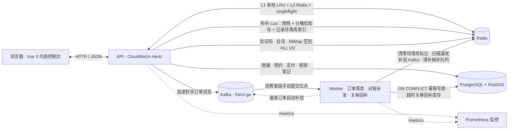

# 小众点评 (xzdp-go)

小众点评是一个基于 Go 和 Vue 3 编写的本地生活与高并发秒杀平台，拆分为 **API** 和 **Worker** 两个独立进程：
- **API 进程**（CloudWeGo Hertz + `embed.FS` 内嵌前端）：负责验证码登录、月度签到领券、附近商铺地理搜索、门店预约、探店笔记社交，以及秒杀抢购受理、支付和核销。
- **Worker 进程**（Kafka 消费者组 + 定时对账）：独立从 Kafka 消费秒杀订单并幂等写入 PostgreSQL，同时负责超时未支付订单自动关单、库存回补与候补递补，以及崩溃漏发订单的自动补发。
- **精简依赖**：保留字节跳动 CloudWeGo Hertz 高性能网络框架，直接用纯 Go 编写路由和处理逻辑（不引入 Thrift IDL、代码生成器和 GORM），运行时仅引入 6 个核心第三方库：`hertz`、`pgx/v5`、`go-redis/v9`、`franz-go`、`prometheus/client_golang`、`golang.org/x/sync`。

## 系统架构



## 核心设计说明

1. **Redis Lua 管极速限购与扣库存，Kafka 管持久化异步削峰。** 秒杀抢券时，先通过预编译 Redis Lua 脚本（`EVALSHA` 缓存）在一次原子执行里校验活动时间、检查一人一单、扣减库存，并写入一条轻量待落库索引；受理后立即通过 `franz-go` 将订单发往 Kafka 持久化队列（Redis 保持正常的 `everysec` 刷盘即可，不需要牺牲缓存吞吐）。支持通过 `STOCK_BUCKETS` 将库存拆成 1–64 个子桶，在热点券场景下分散单键争用。
2. **用定时对账补发解决“扣了库存、发 Kafka 前 API 崩溃”的漏单问题。** 如果 API 进程在 Redis Lua 扣减库存后、消息送达 Kafka 之前意外崩溃，或者遇到短暂网络抖动，待落库索引会留在 Redis 里。Worker 会定时扫描超过等待时间（默认 5 秒）仍未落库的订单，自动重新补发到 Kafka；因为消费端写 PostgreSQL 使用 `ON CONFLICT (id) DO NOTHING` 严格幂等，重复补发完全安全，不会多建单。
3. **Kafka 手动提交消费位点，异常消息转入死信队列。** Worker 从 Kafka 拉取订单，在 PostgreSQL 事务内写入订单、扣减数据库库存并生成通知，确认数据库提交成功后才手动提交 Kafka 位点并清理 Redis 待落库标记。遇到格式错误或数据冲突等无法重试恢复的异常消息，会记录到数据库死信表（`trade_dead_letter`）和 Kafka 死信主题，避免卡住后续正常订单。
4. **超时未支付自动关单、库存回补与候补递补。** 订单超过 15 分钟未付款，Worker 通过 `FOR UPDATE SKIP LOCKED` 批量锁定超时订单，在同一数据库事务中关闭订单、加回数据库库存并记入待释放表（`trade_release`）；随后通过 Lua 脚本把库存精确归还到原分桶，若当前有候补排队的买家且活动未结束，则原子递补生成新订单并投递到 Kafka。
5. **商铺详情采用多级缓存，同时防缓存击穿和缓存穿透。** 查询商铺详情时先查进程内有界 LRU 缓存（L1），未命中再查 Redis（L2），都未命中则通过 `singleflight` 把同一时刻的并发回源合并成一次数据库查询。缓存项采用逻辑过期策略：超过刷新时间后先返回旧值并在后台异步刷新，避免并发打穿数据库；不存在的商铺会写入 15 秒短空值缓存防穿透。
6. **用 PostGIS 空间索引做附近商铺搜索，用 Redis 位图做签到统计。** 商铺坐标建立 PostGIS 地理索引，附近找店结合 `ST_DWithin` 距离过滤、分类筛选与关键词排序，一次查询返回精确距离。用户月度签到存入 Redis BitMap（每天 1 bit），高效统计本月累计天数与连续签到天数，满勤后在事务内自动发放普通优惠券。
7. **低基数监控指标与平滑停机。** API 和 Worker 均暴露 `/livez`（存活检查）、`/readyz`（就绪检查）和 `/metrics`（Prometheus 指标），标签仅保留路由模板和固定操作枚举，不放入商铺 ID、用户 ID 或订单号。收到 `SIGTERM` 停机信号后，服务先将 `/readyz` 切换为 503 停止接入新流量，排空 Kafka 生产者缓冲并完成当前消费批次后优雅退出。

## 性能测试结果

测试环境：Apple M4、macOS arm64、Go 1.27.3；PostgreSQL 17.6、PostGIS 3.5.3、Redis 8.8.4、Apache Kafka 3.9.1。本机单轮实测，完整数据与复现命令见[性能测试报告](docs/benchmarks.md)。

| 测试场景 | 测试条件 | 实测结果 |
|---|---|---|
| 秒杀并发与崩溃补发（单桶 / 八桶） | 200 并发抢 100 张券 + 各模拟 10 笔扣库存后未发 Kafka | 均落库 **100 / 100**，漏发自动找回 **10 / 10**，超卖/重复/丢单全为 **0**；单桶受理 **16,152 QPS**（P99 12.22 ms），八桶 **10,836 QPS**（P99 18.44 ms） |
| 商铺多级缓存击穿保护 | 200 并发冷读同一商铺 | 仅回源数据库 **1 次**（`singleflight` 合并生效），吞吐 **139,381 QPS**（P99 1.25 ms） |
| 商铺缓存读取（L1 / Redis） | 64 并发，5,000 次读取 | L1 进程内缓存 **168.6 万 QPS**（P99 0.64 ms）；Redis 缓存 **59,996 QPS**（P99 4.89 ms） |
| PostGIS 附近商铺搜索 | 10,000 家商铺，20 并发，带关键词与距离排序 | **3,307 QPS**，P50 **4.14 ms**，P99 **36.56 ms** |

## 核心接口

| 方法与路径 | 说明 |
|---|---|
| POST `/user/email/code` · `/user/email/login` · `/user/logout` | 获取验证码、登录（返回 Bearer Token）与退出登录 |
| POST `/user/sign` · GET `/user/sign/reward` | 每日签到、查询本月累计/连续签到与满勤领券进度 |
| GET `/shops/search` · GET `/shops/{id}` · GET `/categories` | 附近商铺地理搜索、商铺详情（多级缓存）与分类列表 |
| GET `/shops/{id}/slots` · POST `/slots/{id}/bookings` · `/bookings/{id}/cancel` | 查看门店可预约时段、幂等预约与取消预约 |
| GET `/vouchers` · POST `/vouchers/{id}/buy` · `/vouchers/{id}/wait` | 查看优惠券、秒杀抢购与售罄候补排队 |
| GET `/orders` · GET `/orders/{id}` · POST `/orders/{id}/pay` · `/cancel` · `/redeem` | 查询订单与排队状态、模拟支付生成核销码、取消订单与门店核销 |
| GET/POST `/notes` · GET `/feed` · POST `/notes/{id}/like` · `/comments` | 探店笔记、关注流、点赞与评论 |
| POST/DELETE `/following/{id}` · GET `/following/{id}/common` | 关注/取关与共同关注查询 |
| GET `/livez` · `/readyz` · `/metrics` | 存活检查、就绪检查与 Prometheus 监控指标 |

## 项目结构

```text
xzdp-go/
├── cmd/
│   ├── api/            # Hertz HTTP 服务启动入口（含内嵌前端）
│   ├── worker/         # Kafka 秒杀订单落库、对账补发与超时关单进程入口
│   └── bench/          # 缓存、秒杀一致性与 PostGIS 附近搜索压测工具
├── internal/
│   ├── cache/          # 进程内 LRU + Redis + singleflight 逻辑过期多级缓存
│   ├── httpapi/        # Hertz 路由注册、鉴权/限流/UV 中间件、内嵌静态资源与平滑停机
│   ├── metrics/        # 低基数 Prometheus 指标注册
│   ├── mq/             # 基于 franz-go 的 Kafka 生产与手动位点消费封装
│   ├── shop/           # 商铺详情、PostGIS 附近搜索与门店预约
│   ├── social/         # 探店笔记、评论、点赞、关注与关注流
│   ├── store/          # pgx/v5 连接池、embed.FS 内嵌 SQL 迁移与演示数据初始化
│   ├── trade/          # 秒杀 Lua、分桶库存、Kafka 异步落库、对账补发、支付核销、关单与候补
│   └── user/           # 邮箱/短信验证码登录、会话与 BitMap 月度签到领券
├── frontend/           # Vue 3 + TypeScript + Tailwind CSS v4 暗色体验台（产物内嵌至 Go）
├── deploy/             # Prometheus 采集配置
├── docs/               # 性能测试报告与原始数据
├── Makefile
└── docker-compose.yaml
```

## 快速开始

先复制环境变量模板（默认开启演示验证码和模拟支付，方便本地体验），一键启动 PostGIS、Redis、Kafka、API 和 Worker：

```sh
cp .env.example .env
make up
```

启动后打开浏览器访问 `http://127.0.0.1:8081` 即可体验附近找店、预约、秒杀抢券、模拟支付、门店核销、签到和探店笔记（演示核销店员账号为 `staff@example.test`）。如需同时开启 Prometheus 监控，执行：

```sh
docker compose --profile monitoring up -d
```

本地源码运行需要 Go 1.27、Node 26 以及运行中的 PostGIS、Redis 和 Kafka：

```sh
make api       # 终端 1：启动 API（默认监听 :8080）
make worker    # 终端 2：启动 Worker（默认监控端口 :8082）
```

修改前端后重新构建内嵌静态资源：

```sh
make frontend
```

## 常用配置

| 环境变量 | 说明 |
|---|---|
| `DATABASE_URL` | PostgreSQL（PostGIS）连接地址 |
| `REDIS_URL` | Redis 连接地址（如 `redis://127.0.0.1:6379/0`） |
| `KAFKA_BROKERS` / `KAFKA_TOPIC` | Kafka 地址（默认 `127.0.0.1:9092`）与秒杀订单主题（默认 `xzdp.seckill.orders`） |
| `KAFKA_RECONCILE_AGE` | 待落库订单超过该时长自动触发对账补发（默认 `5s`） |
| `LISTEN_ADDR` | 进程监听地址（API 默认 `:8080`，Worker 默认 `:8082`） |
| `STOCK_BUCKETS` | 秒杀库存分桶数量，范围 `1`–`64`（默认 `1`，热点场景可设 `8`） |
| `DEMO_DATA` / `DEMO_CODES` / `MOCK_PAYMENT` | 演示数据初始化、演示验证码返回、模拟支付开关 |
| `XZDP_SMTP_*` / `SMS_WEBHOOK_*` | 可选的真实邮件 SMTP 或短信回调配置 |

## 监控与验证命令

```sh
make check    # 运行前端检查、gofmt、go vet、go test -race 与 compose 校验
make bench    # 运行真实 PostGIS + Redis + Kafka 压测并更新基准数据
make down     # 停止容器
```
